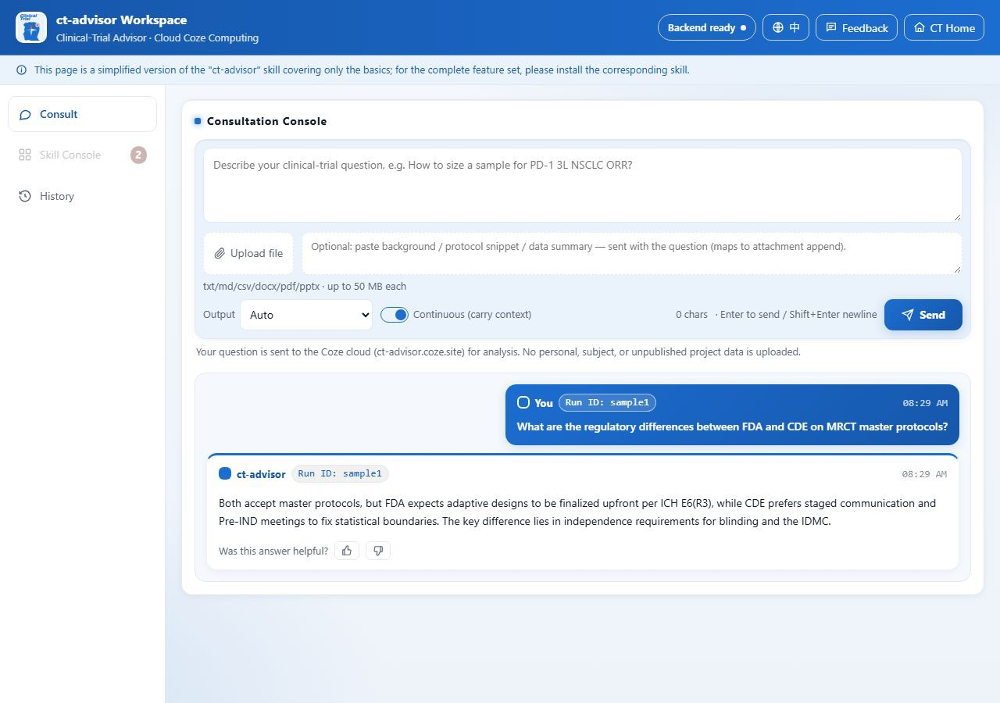

# Clinical Trial Chief Advisor (ct-advisor)

- **English guide** → [README.md](https://github.com/medstatstar/ct-advisor/blob/main/README.md) · **中文指南** → [README\_zh-CN.md](https://github.com/medstatstar/ct-advisor/blob/main/README_zh-CN.md)

> **Works without installation:** If you'd rather not install and just want to quickly use this skill's basic features, you can also visit the ct-series unified web portal **https://ct.medstatstar.com** directly.

  

> **The single front door for the whole `ct-*` clinical-trial skill family — a methodology & regulatory-evidence advisor that also routes real-data / competitive-intel needs to the sibling data skills through a local, code-only orchestrator (`orchestrate.py`) and stitches their results back in code.**
>
> No commands or manual needed. Just describe your trial question **in plain language inside a chat** — the advisor passes every **non-vague** question to the local orchestrator (`orchestrate.py`), which calls a cloud workflow for methodology / study-design / statistics / compliance-response / trial-operations / deliverable-drafting / GCP / safety / regulatory / QC / data-management answers, and when needed runs the right sibling skill (`ct-registry` / `ct-safety` / `ct-literature` / `ct-samplesize`) **locally** and stitches the result **in code**. It **re-implements no** retrieval or computation logic.

---

> **Scope reality check (read this first).** ct-advisor is a **cloud-assisted** advisor, not a pure-local tool. In operation it forwards your **question to the remote analysis engine**; runs sibling `ct-*` skills **locally on your machine** (these skills themselves may query public registries/APIs such as ClinicalTrials.gov, China CDE, FDA FAERS/openFDA, OpenAlex, PubChem); submits an **optional** bug report; keeps a language preference / context cache / memory notes on your device; and runs local connectivity diagnostics. All of this is spelled out honestly in [§5 Data & Privacy](#5-data--privacy).

> **⚠️ Attachments are part of your question.** If you attach a document (≤5 MB, any Word/Excel/PPT/PDF/TXT), the **original file itself is uploaded to the remote analysis engine** (via the `doc_context` file-id channel) and parsed there — nothing stays local. For files >5 MB the skill converts them to Markdown locally and uploads the converted `.md` the same way. Anything inside an attached file — protocol drafts, sponsor names, subject-level details — should be treated as **leaving your machine**. Remove sensitive content before attaching.

## Who This Is For

The `ct-*` clinical-trial skill family is built to address needs across the entire clinical-trial lifecycle, mainly for three groups:

- **Clinical-trial practitioners at pharmaceutical companies** — sponsors, CROs, and medical / statistical / regulatory roles;
- **Clinicians and nurses who design, manage clinical-trial projects, or take part in hands-on trial conduct in medical institutions**;
- **Medical students who want to learn clinical-trial methodology in a structured way**.

---

## 1. What You Can Do — Scenario Index

The advisor covers the entire clinical-trial lifecycle through ten in-house workflows (A–J) plus routing to four sibling skills. Each row below gives the typical **situation** and a line you can **copy verbatim** under "Try saying". The same need may be reached from several entry points.

### Capability domains & authoritative references

ct-advisor's coverage was broadened (v1.3.17) to three previously-uncovered but high-frequency blocks — **regulatory-response / trial-operations / deliverable-drafting** — now first-class in-scope core domains. Full sub-topic catalog + authoritative anchors (ICH / NMPA / CDE / TransCelerate / DIA / CASRAI / EQUATOR, searched 2026-10-22) → **[`docs/capability_domains.md`](docs/capability_domains.md)**.

| Domain | Answers | Key anchors |
|---|---|---|
| Regulatory-response | GCP principles & China GCP, inspection/CAPA readiness, deviations, safety reporting, trial registration & public disclosure (CTR + 30-day clocks), regulatory comms, informed consent | ICH E6(R3) · NMPA GCP 2020 No.57 · CDE Registration Rule 2020 No.9 |
| Trial-operations | Study startup, TMF / essential docs, monitoring models (RBM), RBQM (QTL/KRI), vendor/CRO oversight, enrolment & close-out | TransCelerate RBM & QTL · DIA TMF RM · ICH E8(R1) |
| Deliverable-drafting | Protocol (CPT/eCPT), SAP (ICH E9(R1) estimands + Gamble 55-item), CSR, IB, ICF, device docs (ISO 14155) | TransCelerate CC&R (ICH M11) · ICH E9(R1) · EQUATOR |

### ① Methodology & regulatory advice (answered in-house, A–J)
| Situation                                     | Try saying in chat                                                                                                |
| :-------------------------------------------- | :---------------------------------------------------------------------------------------------------------------- |
| Define a term / find the regulatory basis     | "What does ICH E6(R3) say about risk-proportionate monitoring?"                                                   |
| Trial design review                           | "Review my Phase III oncology design for feasibility"                                                             |
| Statistics / estimand / sample size framework | "Help me set the primary estimand for a superiority trial"                                                        |
| GCP / deviation / audit readiness             | "What makes a site audit-ready under GCP?"                                                                        |
| Safety & operations (SUSAR / DSUR / signal)   | "How do I handle a SUSAR in a multinational trial?"                                                               |
| Documents & QC (CSR / protocol / SAP)         | "Redline my CSR discussion section" (basic review / rewrite; for deep multi-role review use `@skill:ct-protocol`) |
| Reply tone / rewrite                          | "Rewrite this patient letter in a warmer tone" (one-off request; cross-session tone memory is not yet enabled)    |

### ② Real data & competitive intel (routed to sibling skills)
> **The bar was tightened (2026-09-10):** a sibling skill is auto-invoked only for a **uniquely-directed** ask — a named data source (NCT / ClinicalTrials.gov / FAERS / PubMed), a named statistic or high-specificity method (PRR / ROR / EBGM / dechallenge-rechallenge / a specific irAE / meta-analysis), or an explicit "retrieval verb + clear object" phrasing (the table below shows these). **Generic words** (signal / literature / trial / safety / design) no longer trigger on their own: the advisor **answers from its own capability first**, then appends an install / invoke **suggestion at the end**.
> | Situation | Try saying in chat |
> |:---|:---|
> | Trial-registry landscape | "Pull registered trials for semaglutide in T2D, 2021–2026" |
> | Safety signals (FAERS) | "Any FAERS disproportionality signals for drug X?" |
> | Published literature | "Find systematic reviews on GLP-1 RA in obesity" |
> | **Full competitive intel (multi-source, round by round ⭐)** | "Full competitive-intel picture for GLP-1 RA in obesity" |

### ③ Compute handoff (to ct-samplesize)
| Situation        | Try saying in chat                                           |
| :--------------- | :----------------------------------------------------------- |
| Actual n / power | "Sample size: two means, d=0.5, power 80%, α=0.05 two-sided" |

### ④ Clarify mode (Local Clarify Loop, no sibling skill, no network)
| Situation              | Try saying in chat                                 |
| :--------------------- | :------------------------------------------------- |
| Not sure what you need | "I'm not sure what I need — help me figure it out" |

> The underlying sibling skills are described in their own READMEs; ordinary users only need to say what they want in plain language — the advisor routes and stitches. **Whenever the advisor calls a sibling skill, the answer ends with a 💡 line suggesting you run that skill directly if you want to verify it or get the full detailed output.**

---

## 2. Case Collection

ct-advisor is a **conversational skill**: you simply tell the assistant what you're working on — no commands, no parameter names to remember. As a WorkBuddy skill it **auto-loads with no extra installation**, and activates only when you call it via the Skill tool (not automatically in the background).

Below are **8 real cases**, graded by difficulty (★ basic / ★★ advanced / ★★★ professional), matching the Scenario Index in §1. Each case has three parts: **"You say"**, **"The reply you see"**, and **"🖥️ Workbench"** (how to run the same thing in the web workbench). The "reply you see" below are captured from **real runs of the skill** (machine markers stripped), reproduced as-is with no factual rewriting; for queries that need real data, the skill **hands off to the relevant sibling skill** running locally — it does not run the data itself nor fabricate numbers.

### ★ Basic usage

### Case 1 · Subject withdrew early — pay the full travel allowance? (GCP, answered directly)

**You say:**
> The protocol states subjects who complete all visits get a CNY 5,000 travel allowance. One subject withdrew early due to an SAE — must the investigator pay the full amount? What does GCP require?

**The reply you see:**
> **The investigator is generally not required to pay the full CNY 5,000 travel allowance; only the amount proportional to the visits the subject actually completed shall be paid.** The travel allowance compensates the actual travel costs a subject incurs during the trial — not a fixed reward for participation. Since this subject withdrew early due to an SAE and did not complete all visits, the costs for the uncompleted visits did not actually occur, so the full allowance need not be paid.
>
> Under the 2020 edition of the *Good Clinical Practice* and ICH E6(R2), subject compensation must be fair and reasonable, matched to the actual burden and risk of participation, and must not include inducement clauses that only release the full cost-type allowance upon completion of all visits. If the IRB-approved protocol explicitly states that early withdrawal for non-subjective reasons (e.g. treatment discontinuation due to an SAE) still qualifies for the full travel allowance, the full amount may be paid per the protocol.
>
> Basis: *Good Clinical Practice for Drug Clinical Trials* (2020 edition); ICH E6(R2) requirements on subject rights protection and economic compensation

**🖥️ Workbench:** Open the workbench interface, type your question into the chat box, and click send.

### Case 2 · IB lists a reaction as "uncommon" but the trial rate hit 15% — update IB and label? (pharmacovigilance, answered directly)

**You say:**
> An adverse reaction is listed as "uncommon" in the IB, but the observed rate in the trial reached 15%. How should PV assess whether the IB and the label need updating?

**The reply you see:**
> When an adverse reaction's observed incidence reaches 15% in the trial — far above the "uncommon" level stated in the IB — the PV team should follow a three-step assessment (data verification → threshold comparison → clinical risk evaluation), and **by default, if the three conditions (statistically sound, exceeding the IB's defined threshold, and presenting a clinical risk signal) are met, an IB update must be initiated immediately, and for marketed products a label-update argument should be launched in parallel**, with the core aim of promptly syncing new safety information to investigators and regulators to protect subjects.
>
> 1. **Data verification**: confirm data validity — unify the MedDRA coding of the reaction, confirm all cases' causality is judged related to the investigational drug, rule out confounding from concomitant medication / underlying disease, use the total exposed population (all subjects who received at least one dose) as the denominator, and confirm 15% is a stable population-wide incidence rather than bias.
> 2. **Threshold comparison**: compare against the incidence grading threshold explicitly stated in the IB; "uncommon" is generally 0.1%–1% (⚠️ pending verification — use the IB's explicit definition), and 15% exceeds expectations by over 15×, crossing grades and triggering the statutory update obligation.
> 3. **Clinical risk evaluation**: if the reaction is moderate-severe, lacks effective intervention, or shows unexpected serious outcomes, update the IB's Safety Reference Information (RSI) section immediately and report to the regulator; for mild, intervenable reactions, also update the incidence data in the IB's "observed adverse reactions" list.
>
> Basis: ICH E2A *Clinical Safety Data Management: Definitions and Standards for Expedited Reporting*; CDE *Guidelines for Writing the Safety Reference Information (RSI) in the Investigator's Brochure*
>
> If you like, I can expand on: ① the IB-update regulatory submission flow ② quantitative signal-verification methods ③ label-update communication requirements for marketed products

**🖥️ Workbench:** Open the workbench interface, type your question into the chat box, and click send.

### Case note · how data-bound queries are answered (example: registry search)

> Queries that need real data (registry trials, safety signals, literature, sample size) are **not answered with figures inside the chat**. The skill first gives a methodology framework and then hands off to the corresponding sibling skill running locally. Case 3 is a real example.

### Case 3 · Pull a drug's registration trials (handoff to ct-registry)

**You say:**
> Pull the registered trials for semaglutide in type-2 diabetes, 2021–2026.

**The reply you see:**
> 💡 *Note: the following is compiled from publicly available general knowledge; verify key figures and conclusions against authoritative sources (nmpa.gov.cn / cde.org.cn / ich.org).*
>
> The knowledge base does not yet contain direct data on semaglutide T2D registration trials for 2021–2026; retrieve it via the official frameworks below:
> 1. **Authoritative sources**: CDE Trial Registry (chinadrugtrials.org.cn), ClinicalTrials.gov, EudraCT, and NMPA/CDE approval notices — all results ⚠️ pending verification.
> 2. **Search filters**: keywords "semaglutide / 诺和泰", "type 2 diabetes mellitus"; limit registration/approval dates to 2021-01-01 – 2026-12-31; keep only registration trials.
> 3. **Key fields**: phase, sample size, control, primary endpoint, status.
>
> ---
> ## Invoke directly: @skill:ct-registry
> Registered locally; the client calls it directly — ct-advisor does not run its CLI, so you get the full deliverable, not a summary.
> - Params identified: cond=semaglutide
> - Deliverable: report.xlsx / report.md (trial landscape + competitor distribution)
>
> The above is ct-advisor's own methodology answer; rely on the skill's actual output for real data, reproducible results and files.

**🖥️ Workbench:** Open the workbench interface, type your question into the chat box, and click send.

## ★★ Advanced usage

### Case 4 · Full competitive-intel on GLP-1 RA in obesity (multi-skill handoff)

**You say:**
> Give me the full competitive-intel picture for GLP-1 RA in obesity — trials, safety signals, and literature.

**The reply you see:**
> The publicly confirmable core competitive-intel for GLP-1 RA in obesity: marketed products include semaglutide, liraglutide, tirzepatide; the pipeline covers weekly injections, oral formulations, and fixed-dose combinations, mostly Phase III; primary endpoints are % weight loss from baseline at 52/68 weeks and % subjects with ≥5%/≥10% weight loss; confirmed common AEs are mild-moderate GI reactions (nausea, vomiting, diarrhea) that ease with titration; watch-list signals include thyroid C-cell tumor risk, acute pancreatitis, gallbladder disease, and severe GI reactions. The detailed trial data, precise signal strength, and full literature entries are cross-skill retrieval needs — below are the standardized frameworks and public baselines; call the dedicated skills for actual values.
>
> **1. Trial-retrieval framework**
> **Professional Tip**: suggested via local **ct-registry** skill: @skill:ct-registry.
> Standard dimensions: ① sources CDE registry, CT.gov, EU CTR, ChiCTR; ② keywords GLP-1R / GLP-1 RA, obesity/overweight, drug intervention; ③ fields phase, sponsor, enrollment, primary endpoint, status.
>
> **2. Safety-signal framework**
> **Professional Tip**: suggested via local **ct-safety** skill: @skill:ct-safety.
> Four-step signal detection: ① sources SAE summaries, FAERS/VigiBase/NMPA ADR, published case reports; ② triggers PRR ≥ 2, χ² ≥ 4, ≥ 3 cases; ③ qualitative causality, biological plausibility, class characteristics.
>
> **3. Literature framework**
> **Professional Tip**: suggested via local **ct-literature** skill: @skill:ct-literature.
> Sources PubMed, Embase, Cochrane, CNKI, Wanfang; prioritize Phase III results, meta-analyses, real-world studies, safety reviews.
>
> Basis: ICH E2E *Pharmacovigilance Planning*; SIGN 154 *Glycaemic Control in Type 2 Diabetes*; ct-advisor cross-skill routing rules
>
> ---
> 💡 *Note: the above is ct-advisor's own answer. This question also involves the following sibling skills, registered locally and directly callable by the client; for **real data, reproducible results, or file deliverables**, call them directly:*
> - `@skill:ct-registry`: multi-source global trial-registry search
> - `@skill:ct-safety`: FDA FAERS disproportionality (PRR / ROR / IC / EBGM)
> - `@skill:ct-literature`: medical literature search across all sources (OpenAlex + Europe PMC)

**🖥️ Workbench:** Open the workbench interface, type your question into the chat box, and click send.

### Case 5 · Phase II oncology design + sample size (framework first, then handoff to ct-samplesize)

**You say (round 1, no parameters):**
> I'm planning a Phase II oncology trial and also need the sample size — help me decide the design.

**The reply you see (round 1):**
> The default recommended design for a Phase II oncology trial is the **Simon two-stage single-arm design**, aimed at preliminarily assessing anti-tumor activity and informing the go/no-go decision for Phase III; typical sample size is 20–60 cases (adjusted by objective and endpoint type), with the precise size depending on preset target effect size, null boundary, α, power, and dropout.
> 1. **Design logic**: default Simon two-stage (stage-1 enroll 10–20 cases; proceed to stage 2 if ORR reaches the preset threshold, else terminate early); for comparing against standard of care, a small randomized controlled design may be chosen, with ORR as the preferred short-cycle primary endpoint.
> **Professional Tip**: precise sample-size calculation is suggested via local **ct-samplesize** skill: @skill:ct-samplesize. Provide the core parameters to get a deployable sample-size result and power curve.
> Basis: ICH E9; CDE *Technical Guidelines for Antitumor Drug Clinical Trials*
>
> ---
> ## Invoke directly: @skill:ct-samplesize
> Registered locally; the client calls it directly.
> - Purpose: sample size / power calculation
> - Params identified: (none)
> - Deliverable: sample-size & power report (with inline charts)
> Suggested params to supply: test; effect-size param (one of): p1 / p2 / effect / sd / margin
> The above is ct-advisor's own methodology answer; rely on the skill's actual output for real data, reproducible results and files.

**You say (round 2, parameters supplied):**
> Test type: two-proportion, p1=0.30, p2=0.45, two-sided α=0.05, power 80%.

**The reply you see (after supply):**
> Based on your two-proportion parameters, with no dropout correction each group needs about 190–200 cases and ~380–400 total; with a preset 20% dropout the total is ~475–500, using the chi-square sample-size formula for two proportions.
> **Professional Tip**: suggested via local **ct-samplesize** skill: @skill:ct-samplesize.
> Preliminary reference (methodology example only, not a formal result ⚠️ pending verification): ~190–200/group, ~380–400 total without dropout; with 20% dropout apply `n_adj = n/(1−dropout)`, total ~475–500. The effect size (p1/p2) must be justified by a source and not assumed.
> Basis: ICH E9 *Statistical Principles*; CDE *Statistical Design Guidelines for Antitumor Drug Clinical Trials (Trial)* (2020)
>
> ---
> ## Invoke directly: @skill:ct-samplesize
> - Purpose: sample size / power calculation
> - Params identified: test=proportion_two
> - Deliverable: sample-size & power report (with inline charts)
> The above is ct-advisor's own methodology answer; rely on the skill's actual output for real data, reproducible results and files.

**🖥️ Workbench:** Open the workbench interface, type your question into the chat box, and click send.

### Case 6 · Not sure what you need (vague → local clarify)

**You say:**
> I'm not sure what I actually need — I have a half-written protocol and some questions.

**The reply you see:**
> Before answering, the following need clarification:
> - Specify the target population / subjects (disease, stage, line of therapy, age band) — it changes applicability.
> - Specify the endpoint / outcome of interest (e.g. OS, PFS, ORR, AE rate).
>
> Please reply to each, and I will continue the analysis based on your added information.

**🖥️ Workbench:** Open the workbench interface, type your question into the chat box, and click send.

## ★★★ Professional usage

### Case 7 · PD-1 product ILD signal — literature support level (multi-skill handoff)

**You say:**
> One of our PD-1 products has case reports of interstitial lung disease; QA suspects a new safety signal. Search the published literature for how much support this signal has, and give me a citable evidence summary.

**The reply you see:**
> ⚠️ **Safety note**: this question spans multiple sibling skills (ct-safety, ct-literature); it is a complex combined call. Consider splitting it into separate questions for more accurate, verifiable results. If there is **no response for a long time**, abort and re-ask by splitting.
>
> No directly matched published literature was found to assess the support level for your PD-1 product's ILD case; a standardized retrieval workflow is required, and the full citable evidence summary must be generated by the ct-literature and ct-safety skills.
> **Professional Tip**: suggested via local **ct-literature** + **ct-safety** skills: @skill:ct-literature @skill:ct-safety.
> Support-level assessment method: ① sources PubMed, Embase, CNKI, Wanfang, plus NMPA/FDA/EMA safety alerts; ② grading: high (≥3 independent primary studies) / medium (only 1–2 product-specific case reports) / low (only this single reported case); ③ qualitative check: verify drug duration, dechallenge/rechallenge, and rule out infection/tumor progression/underlying lung disease.
> Citable-evidence-summary structure (6 parts): header, search method, result summary, support-level judgment, action recommendations, reference list (GB/T 7714).
> Basis: ref-safety-practical.md §1.1 four-step signal detection; ref-reg-safety.md §4.6 signal detection and disproportionality
> If you like, I can expand on: ① a custom search strategy for this product ② support-level grading rules ③ a complete evidence-summary example
>
> ---
> ## Invoke directly: @skill:ct-literature
> Registered locally; the client calls it directly.
> - Purpose: published-literature search (OpenAlex / Europe PMC / Semantic Scholar)
> - Params identified: (none)
> - Deliverable: lit_report.xlsx / references_apa.md (PICO search + PRISMA)
>
> ### Other skills you can invoke directly
> - `@skill:ct-safety`: faers_report.xlsx / faers_report.md (PRR / ROR / IC / EBGM + 95%CI) | params: (none) | to supply: drug (💡 openFDA needs the INN; convert Chinese drug names first)

**🖥️ Workbench:** Open the workbench interface, type your question into the chat box, and click send.

### Case 8 · Protocol intro evidence + superiority sample size (ct-literature + ct-samplesize)

**You say (round 1, no parameters):**
> We're drafting a phase-3 protocol in this indication. Give me the published RCT and systematic-review evidence from the last 5 years for the introduction, then compute the sample size for a superiority design.

**The reply you see (round 1):**
> ⚠️ **Safety note**: this question spans multiple sibling skills (ct-samplesize, ct-literature); it is a complex combined call. Consider splitting it into separate questions for more accurate, verifiable results. If there is **no response for a long time**, abort and re-ask by splitting.
>
> Your Phase III intro's last-5-year evidence can follow this framework: sources PubMed/Embase/Cochrane/CT.gov/CDE, time 2021–present, keywords [indication + target/mechanism + RCT/systematic review/Meta-analysis], extract efficacy data matched to your population and do bias assessment; superiority sample size defaults to two-sided α=0.05, power 80%, dropout 15%, combined with retrieved effect sizes.
> **1. Last-5-year RCT & systematic-review framework**: also call local ct-literature/ct-registry: @skill:ct-literature @skill:ct-registry.
> **2. Superiority sample-size framework**: call local ct-samplesize: @skill:ct-samplesize.
> If you like, expand on: ① search-strategy construction ② sample-size assumption justification template ③ adjacent superiority-design questions
> Basis: ICH E9; ICH E9(R1) *Estimands*; ICH E10 *Comparative Controls*; CDE *Statistical Guidelines*

**You say (round 2, parameters supplied):**
> Two-proportion, p1=0.30, p2=0.50, two-sided α=0.05, power 80%.

**The reply you see (after supply):**
> ⚠️ **Safety note**: this question spans multiple sibling skills (ct-samplesize, ct-literature); it is a complex combined call. Consider splitting it into separate questions for more accurate, verifiable results. If there is **no response for a long time**, abort and re-ask by splitting.
>
> Your Phase III superiority protocol work proceeds in three parts: ① anchor the estimand and superiority boundary per ICH E9(R1); ② retrieve last-5-year evidence via local ct-literature/ct-registry; ③ compute sample size via local ct-samplesize using retrieved historical effect sizes.
> **1. Phase III superiority methodological considerations**: per ICH E9(R1) define the five estimand attributes; control selection per ICH E10 (prefer standard of care); default two-sided α=0.05, power 80%–90%; stratify by center in multi-center trials.
> **2. Last-5-year RCT & systematic-review framework**
> **Professional Tip**: via local **ct-literature/ct-registry**: @skill:ct-literature @skill:ct-registry.
> Fallback framework: sources PubMed, Embase, Cochrane, CT.gov, CDE; time last 5 years; keywords [indication + target/mechanism + RCT/systematic review/Meta-analysis].
> **3. Superiority sample-size framework**
> **Professional Tip**: via local **ct-samplesize**: @skill:ct-samplesize.
> Fallback logic: clarify primary endpoint type, expected effect size (from retrieved RCT data, not assumed), α, power, allocation ratio, dropout (usually 10%–20%).
> If you like, expand on: ① intercurrent-event strategy ② search-strategy example ③ sample-size assumption template
> Basis: ICH E9; ICH E9(R1); ICH E10; CDE *Statistical Guidelines*

**🖥️ Workbench:** Open the workbench interface, type your question into the chat box, and click send.

---
## 3. First-Time FAQ

**Q: I only gave a partial description — will it still help?** A: Yes. Every question is forwarded to the remote analysis service for processing — there is no local knowledge pack. If the service is unreachable, the answer says "please retry" rather than falling back to local materials. Data asks are routed to the relevant sibling skill by default; if you want to limit the scope, just say so in your question.

**Q: How are data sources labeled in the answer?** A: Measured behaviour is a **section label**: code appends the sibling skill's measured output under `## 补充信息（来源：ct-xxx）` (**measured: no date**; the English form is `## Supplementary data (Source: ct-xxx)`), and the full list / evidence is exported to `./out/` (`report.xlsx`, `lit_report.xlsx|html`, `evidence_log.json|md`). That is how you trace each number back to the sibling skill that produced it; the answer also ends with a 💡 suggestion to run that sibling skill directly for the fuller original output.

**Q: It says a sibling skill isn't installed — do I have to install it?** A: **No — the decision is yours, and nothing is ever installed without your say-so.** Sibling skills come in two tiers, and the tier is separate from whether a skill is published. **Tier A** (`ct-registry` / `ct-safety` / `ct-literature` / `ct-samplesize` etc. — non-confidential input) that is **listed on SkillHub**: if missing locally, the advisor explains what it does and **suggests installing it** — it checks the SkillHub listing and **offers** to install it for you, but **does not install anything by itself**, because installing writes a package into your local skills directory and **may trigger a security prompt**. You choose: run the command yourself, or **explicitly authorise** the advisor to do it — then it installs, calls the skill and returns live results. **Decline** → it answers from its own capability (cloud answer) and clearly labels the reply **"data not retrieved"**. If a Tier-A skill is **not yet listed** (e.g. `ct-pipeline`), the advisor says it has not been publicly released and **cannot be installed right now** — it will not hand you an address that installs an empty package — then answers from its own capability plus the installed siblings, labelled "data not retrieved". **Tier B** (e.g. `ct-protocol` / `ct-csr` / `ct-analysis` / `ct-sdtm` — confidential protocols / subject data / CRFs): these are **not publicly released and cannot be installed**, so the advisor states plainly that a Tier-B skill is needed but is not publicly available, then completes the analysis from its own capability and notes that the in-depth analysis was not actually executed. Nothing is ever installed without your authorisation (by default installation is only *suggested*), and unavailable data is never fabricated.

**It hands off to the sibling skills for real data (since 2026-11-09).** For `data_intel` asks the advisor emits a directly-invocable `@skill:<slug>` card by default — the client runs the relevant skill (ct-registry / ct-safety / ct-literature / ct-samplesize) itself and returns the full deliverable (`report.xlsx` / `faers_report.xlsx` / PRISMA…), instead of ct-advisor running a CLI on your behalf and stitching a truncated plain-text summary into the answer. The card is generated **in code** and delivered through the single `entry.py` exit; the local model never chooses or invokes a skill. Ask for the legacy execution card if you prefer the old behaviour, or for a one-shot non-audit brief (off by default). If you only want the plan and not the data yet, say "just show the plan".

**Q: On a Chinese system, is the output in Chinese?** A: Yes. Output language follows your OS setting by default (Chinese on a Chinese-OS, English otherwise), and you can force-switch anytime with one sentence (e.g. "switch to English").

**Q: How is the full competitive-intel brief generated now?** A: Measured behaviour is **round by round**: the first run usually returns a delegate block (`need_tool` + a `need_tools` candidate list + `missing_params`), the advisor **asks you for the missing parameter** (measured: `cond`), and after you supply it **one skill runs per round**, its output stitched into the answer — covering three sources takes several rounds. `need_tools` is only the system's candidate list; it is **not** auto-iterated, and no single "strategic brief" document is produced automatically. This replaces the separate `ct-pipeline` orchestrator.

**Q: Does pure methodology need the network?** A: Yes — every **non-vague** question is sent to a remote analysis service for processing (a `vague` question is clarified locally via the Local Clarify Loop first, then forwarded). If the service is unreachable, the answer says "please retry" — there is no local knowledge pack fallback.

**If a required component is missing:** the skill tells you plainly what is missing and stops — it **never installs anything silently**.

**Q: What if I found an error in the result — how do I report it?**
A: This skill follows the ct-base §20.3 bug-report workflow. If you suspect the result is wrong (or the engine errored), just say **"report a bug" / "上报问题" / "提交错误报告"**. The skill also **proactively asks** whether to report when it detects a likely defect (e.g. the engine errors or retries still fail) — at most **once per session**, and you can always decline. Either way, the assistant will:
1. **Propose a sanitized report** (11-field whitelist: skill / skill_version / test / error_type / error_code / engine_status / description / locale / query_origin / session_hash / attempts — **no raw input values or personal data**, except the `description` field where you decide what to disclose, e.g. the algorithm/function used and the error message);
2. **Show the full report text for your review** — you can add a problem description or correct anything before confirming;
3. **Send after your explicit confirmation** — to the unified reporting endpoint (if this session used the cloud service) or saved locally + emailed to the author (if purely local, data never leaves your machine);
4. **Receive an acknowledgment** — including whether a previously submitted report from your source has already been fixed (with the fix note) or is still pending.

You stay in full control: the report is shown to you **before** anything is sent, and nothing is transmitted without your explicit "send" confirmation.

**Q: What if my data must stay confidential?** A: The advisor only sends your **question text** to the analysis endpoint (`https://ct-advisor.coze.site/run`) — never your raw trial / patient / sponsor data. Outbound payloads pass through `sanitize()` first (strips IDs, phone numbers, emails, and a small set of sensitive keywords; `query_origin` is a non-PII `sha256` machine id, `locale` is your OS language). Sibling data skills (ct-registry / ct-safety / ct-literature / ct-samplesize) run **locally** and only their results cross back; confidential data never leaves your machine. If you have strict confidentiality needs, simply keep real patient / sponsor data out of your question — the advisory answers are framework-level and don't require exposing it.

**Q: Is there a depth limit on protocol review?** A: Yes. The cloud side only does a **basic** protocol review (point-by-point + severity grading + revision suggestions). For a **deep multi-role review** (PI / site / regulator / rationale perspectives, revision-risk scoring on dimensions D1–D9, a structured review.json, annotated .docx output, run locally offline), explicitly call `@skill:ct-protocol`; this advisor does not impersonate that capability. Since v1.3.39, when your question carries protocol-review intent (`方案` + `评阅/审阅/评审/审查/批注/修订/修改意见`, or `protocol review/audit/assessment`), the advisor also appends an answer-footer **soft suggestion** pointing at `ct-protocol` — it never auto-invokes it, so the choice to switch stays yours.

**Q: Will formal deliverables (protocol / review / computation) be illustrated?** A: **No.** Formal documents such as the protocol body, protocol-review comments, and sample-size computation sheets stay as plain text. For data / explanation / decision / flow / comparison results that warrant visualization, an **independent appendix** is offered only after your confirmation and is never embedded in the body (see the Graphical-rendering note below in §4).

**Q: Does meta-analysis (forest plot / R recompute) run automatically?** A: **No, not automatically.** Meta-analysis requires you to explicitly call `@skill:meta-analysis` (R recompute / forest plots are done by that skill); this advisor only refers you to it.

**Q: Does a rewrite remember my tone preference?** A: **No, not across sessions.** Rewrites are one-off, stateless requests; the personalized tone / memory function (tone_profile + memory_context) is currently DEFERRED (the v1.5 field is not implemented), so every rewrite ignores history.

---

## 4. Execution Model & Safe Preview

### Safe Preview (handoff card only for a uniquely-directed ask; otherwise answer first, suggest last)
- **Handoff card only for a uniquely-directed ask (since 2026-11-09):** only a **strong trigger** — a named data source (NCT / FAERS / PubMed…), a named statistic / high-specificity method (PRR / ROR / EBGM / meta-analysis…), or an explicit "retrieval verb + clear object" phrasing — makes the **code** emit an `@skill:<slug>` card carrying the params already extracted from the question, any missing params, the skill's real deliverables and a Tier-B confidentiality note. The client can invoke every locally registered `ct-*` skill directly, so ct-advisor no longer runs their CLIs or bypasses SAFE PREVIEW. Measured: **one card names one skill**; `CT_ADVISOR_HANDOFF=0` restores the legacy auto-execution behaviour.
- **Generic words and consultation questions → answer first, suggest last:** for a bare generic word (signal / literature / trial / safety / design) or a "what is / how do I / give me a template" methodology, definition or document question, the advisor **answers fully from its own capability** (cloud knowledge base + authoritative anchors) first; only when the question **does name** a data source / statistic (FAERS, PRR, PubMed…) does it append an `@skill:xxx` **suggestion at the end** — a purely generic or definition question no longer trails any suggestion, and it never interrupts the answer or pops a parameter follow-up because of a keyword false positive.
  - **Technical-detail questions are answered by the advisor itself (since 2026-11-09):** "How is a non-inferiority margin set", "what is the relation between alpha-spending and interim analyses", "PRR vs ROR and why EBGM shrinks", "how to read a 95%CI", "why does CT.gov have Phase 1/Phase 2" — these ask about **principles / parameter semantics / method choice / interpretation**, and are no longer misrouted to sibling skills that only compute or retrieve. The test is "is there an execution verb plus computable/retrievable input", not "does the word PRR or sample size appear". Answers carry a "methodology explanation, not a data result" marker, authoritative sources and an anti-hallucination rule (no invented trial counts / PRR values / sample sizes); an `@skill:` suggestion appears only at the end when actual computation is wanted. The three methodology topics live **only in the cloud knowledge base** — the local skill keeps zero knowledge base.
- **One card per skill in mixed asks:** if a question hits several sibling skills at once (e.g. a competitive-intel picture needing registry trials + FAERS signals + published literature), the answer appends an "Other skills you can invoke directly" section after the primary card, with one `@skill:<slug>` card per skill. Params are split by each skill's own CLI allowlist and missing params are listed separately, so `topic` is never handed to `@skill:ct-registry`.
- **Return path after the skills run:** once the sibling skills finish, say 「把结果汇总一下」 / "stitch the results together" and the advisor merges their deliverables into one deterministic summary — **locally**, with zero egress by default, no LLM and no numeric rewriting; Tier-B confidential outputs stay on this machine. Credential-like filenames, oversized files and unsupported formats are refused; missing outputs are reported, never invented.
- **Optional result interpretation (sanitized egress):** ask for a methodology explanation of the results. **Only** allowlisted sanitized numbers (max 12 finite values, taken from JSON outputs alone) and a code-built methodology question are sent to the pre-authorized endpoint. The user's original question, raw output text, file names/paths, drug or protocol names, trial IDs and subject data never leave the machine. If the endpoint is not whitelisted, no allowlisted values exist, or the cloud returns an error / `need_tool` / empty answer, only the local summary is delivered with the reason stated.
- **Chinese mixed questions get params too:** multi-skill asks fill `cond` for ct-registry and `topic` for ct-literature. ct-safety's `drug` is deliberately **not** filled with a Chinese name (openFDA only accepts English generic names and would return zero hits); its card gives a conversion hint instead. The single-skill lexicon rules are untouched.
- **Plan only:** if you only want the plan and not the data yet, say "just show the plan".
- **Traceable, not fabricated:** Every factual / normative claim carries a source citation (code-appended measured results read `## 补充信息（来源：ct-xxx）`) or an `⚠️ needs official verification` marker; it never fills factual gaps with fluent prose.
- Outputs are for reference only; validate against official sources before regulatory submissions.

### Graphical-rendering note
- **Formal deliverables stay plain text:** the protocol body, protocol-review comments, regulatory-communication files, and sample-size computation sheets — the "finished products you hand off" — default to **no graphics**, preserving formality and traceability.
- **Data / explanation may be illustrated:** results involving multi-branch decisions, sequential flows, hierarchy, design comparison, or severity grading may use decision trees / flowcharts / comparison matrices / severity color blocks to aid understanding.
- **Independent appendix, only with your OK:** any visualization is delivered as an **independent appendix** and never embedded in the formal body; especially for formal documents, if you want a visual aid, confirm first and I'll generate an appendix that does not alter the original text.
- **Pipeline safety:** since v1.3.21 there is **no base64 anywhere** in the pipeline — the answer leaves `entry.py` as plain text followed by `<<<CT_ANSWER_END>>>`, `checksum:` and `answer_file:`. The exit writes UTF-8 bytes directly to `stdout.buffer` (no code-page inspection, no flags) and stores the identical bytes at `_answers/<sha16>.md`. If a terminal renders the text garbled (a display-layer issue only), **read the path given on the `answer_file:` line** — since v1.3.23 it is **absolute and pure ASCII**, so it survives the very capture that mangled the body, and one file read returns the original bytes (file reads are independent of the console code page). No re-run. **Keep the two acts apart:** "read the file" is allowed, "decode the mojibake" is not — a cp936 console replaces illegal UTF-8 bytes with `U+FFFD`, so the original bytes are gone; no repair chain or model guess can pass the checksum, and "repairing" an answer is a rewrite (ALCOA+). Since v1.3.22 the answer file is **reused rather than rewritten** when an identical one exists (network-share ACL refuses overwrite), and if `_answers/` is unwritable the engine falls back to `%TEMP%/ct-advisor/<sha16>.md` — so the "one intact plain-text copy" channel cannot vanish silently.

### Latency note
Every **non-vague** question is handled by the advisor's local orchestration layer, which forwards to a remote analysis service (async submit + poll; a sync fallback is kept only for endpoints without async support). The polling deadline is 90 s (300 s for long tasks); **measured 3–72 s per round**, mostly 30–70 s, and data-intel questions also run the needed sibling skill locally. **A timeout is not a hard error**: the answer falls back to the local draft (not cloud-polished) with a clear fallback notice. A `vague` question is clarified locally first (a few seconds via the Local Clarify Loop), then re-routed. Because the orchestrator, prefetch, merge, and stitching are all **code** (not the LLM), dependence on the local model's performance is low — but reasoning models (e.g. Hunyuan-3, DeepSeek-R1) have been observed to over-think locally. **If a single reply routinely takes longer than 3 minutes, switch to a simpler / flash model to speed things up.**

---

## 5. Data & Privacy

**This skill is cloud-assisted, not a pure-local tool.** To give current, source-traced answers it forwards your question to a remote engine and may run sibling skills on your machine. Below is exactly what leaves your device, what stays local, and what sensitive actions it can take — stated up front, not buried.

### What leaves your device (off-device)
- **Analysis request** — for a non-vague question, your **question text** (passed through `sanitize()` first, which strips IDs, phone numbers, emails, and a few sensitive keywords) is sent to `https://ct-advisor.coze.site/run`. **Raw trial / patient / sponsor data is never sent.** When the question needs registry / safety / literature / sample-size data, the service returns only a `need_tool` instruction; the actual retrieval and computation run **locally** on your machine — but note those local sibling skills (`ct-registry` / `ct-safety` / `ct-literature` / `ct-samplesize`) may themselves query **public registries/APIs** (ClinicalTrials.gov, China CDE, FDA FAERS/openFDA, OpenAlex, PubChem…). That is separate outbound to those public sources, not to Coze.
- **Error report** — sent **only after your explicit confirmation**, and only as an 11-key whitelist envelope (no raw input, no PII), to the unified reporting endpoint. You can always decline; it is offered at most once per session.

Each request also carries two anonymous metadata fields: `query_origin` (a SHA-256 hash of your hostname, for rate-limiting only) and `locale` (your OS language, for answer-language matching). Neither contains PII.

### What stays on your device but is still sensitive (on-device actions)
To be transparent about the full behavior the skill can perform:
- **Embedded (public) token** — the skill ships with an obfuscated token used to authenticate the public endpoint. It is a **shared, openly-disclosed token by design** (not a personal secret); it is decoded in memory only for outbound auth and is disclosed openly here rather than hidden.
- **Local persistence** — it may store your **language preference**, keep a short-lived **context cache**, and **promote recurring interaction patterns into long-term memory notes**, all on your own machine. None of these contain your question text or trial data.
- **Local connectivity diagnostics** — if a connection to the service fails, with your permission it runs a local connectivity check (proxy / network / credential) and suggests a fix.
- **Local orchestration** — sibling `ct-*` skills run **locally on your machine**, and their results are stitched together by code rather than by the model.
- **No translation egress (clarification)** — the package carries shared ct-base modules to stay self-contained, but **ct-advisor never uses any online translation path**, so **no translation egress is ever produced**.

> **In one sentence:** your question text goes to the cloud analysis endpoint, sibling skills may query public registries, an optional bug-report goes out only after your OK, and the skill may keep a language preference / context cache / memory notes locally — **raw trial / patient / sponsor data never leaves your machine.**

---

## Why You Can Trust the Output — Anti-Hallucination

ct-advisor is the entry point that routes to sibling skills and forwards questions to the cloud refiner; it does not invent facts. Four guardrails apply:

1. **Every factual claim is source-traceable.** Data-grounded claims from sibling skills are appended by code as `## 补充信息（来源：ct-xxx）` (measured: the label carries no date; artifacts land in `./out/`); methodology / regulatory answers cite the authority (ICH / NMPA / FDA / EMA guidance) and link to it where available.
2. **Identifier consistency check.** When a cited identifier (trial registration number, DOI / PMID) is resolved to a live record, the resolved title / author / year are compared against the original assertion; a mismatch is flagged `mismatch` and never treated as verified.
3. **Unverifiable ⇒ `⚠️ needs official verification`.** Anything that cannot be traced to a public source is marked for official verification and never stated as a confirmed conclusion.
4. **No fabrication.** Trial registration numbers, approval dates, subject counts, and company M\&A / pipeline moves are never invented; if a public source does not disclose them, the output says "not disclosed in public sources".

---

**Version**: v1.3.46 | **License**: MIT | **Authors**: medstatstar, phoe-zip

For feature requests, bug reports, or other feedback, please contact the author directly at <medstatstar@gmail.com> (Wintone Zhang).

---

## Confidentiality Notice

> The CT series consists of 20+ specialized domain skills, organized into **two tiers — A, B** — by "whether the input contains confidential information" (network / egress / publish are independent orthogonal attributes; see ct-base §11), providing full coverage of the entire new-drug clinical trial (Clinical Trial) lifecycle.
>
> - **Tier A (non-confidential input)**: runs on ordinary data and involves no confidential information; split further by the `network` sub-attribute into three kinds — ① **fully local** (`network=off`, zero egress); ② **public-source retrieval** (`network=public-retrieval`, e.g. ct-registry / ct-safety / ct-literature — only public query terms leave the machine); ③ **controlled cloud-only egress** (`network=controlled-coze-opt-in`, e.g. **ct-advisor**: a single cloud endpoint only, explicit user opt-in, payload passed through `sanitize()` first, paired with `egress=cloud`). ⚠️ Note that ③ is **not** the same as "runs fully locally" — its Q\&A is forwarded to the cloud engine by default, falling back to a local fallback answer (clearly marked as such) only when the cloud is unreachable. All Tier A skills are published openly on GitHub.
> - **Tier B (confidential input)**: accept strictly confidential clinical-trial data / protocols / CRFs from pharma sponsors (e.g., ct-analysis, ct-sdtm, ct-protocol, ct-eligibility); Tier B is processed locally and never leaves the boundary (egress=none), or additionally requires policy approval (egress=approval-req, e.g. ct-eligibility). Tier B packages contain zero confidential data but are NOT publicly published (stays fully local) — confidential input never ships with the package or leaves the machine. For custom / on-prem deployment, contact the author.
>

> 🌐 Other languages: [中文 README](README_zh-CN.md)
