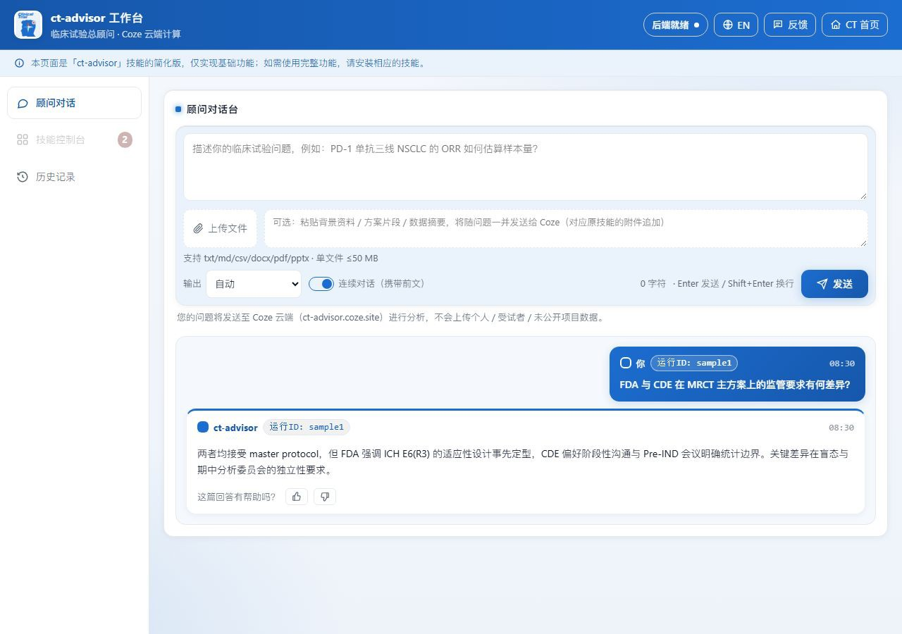

# 临床试验总顾问（ct-advisor）

- **English guide** → [README.md](https://github.com/medstatstar/ct-advisor/blob/main/README.md) · **中文指南** → [README\_zh-CN.md](https://github.com/medstatstar/ct-advisor/blob/main/README_zh-CN.md)

> **不安装也能用：** 如果你不想安装，只想快速使用本技能的基础功能，也可直接访问ct系列技能的总入口网页 **https://ct.medstatstar.com** 使用。

  

> **整个 `ct-*` 临床试验技能家族的统一入口 —— 既是方法学与法规证据顾问，也通过本地代码编排器（`orchestrate.py`）把真实数据 / 竞品情报类需求路由到兄弟数据技能并在代码内缝合结果。**
>
> 不需要命令，也不需要手册。你只要在对话里用**自然语言**说清你的试验问题：顾问将**非模糊**问题交给**本地代码编排器**（`orchestrate.py`），由它调用云端工作流作答方法学 / 方案设计 / 统计学 / 合规应答 / 项目运营 / 交付物撰写 / GCP / 安全性 / 法规 / QC / 数据管理类问题，并在需要时在**本地**运行对应兄弟技能（`ct-registry` / `ct-safety` / `ct-literature` / `ct-samplesize`）、把结果在**代码内缝合**；它**不重复实现**任何检索或计算逻辑。

---

> **范围现实核对：** ct-advisor 是**云端辅助**顾问，而非纯本地工具。它工作时需要把你的**问题转发到远程分析引擎**；在**本机本地**运行兄弟 `ct-*` 技能（这些技能本身可能查询 ClinicalTrials.gov、中国 CDE、FDA FAERS/openFDA、OpenAlex、PubChem 等公开注册库/API）；提交**可选**的错误报告；在你的设备上保留语言偏好 / 上下文缓存 / 记忆笔记；以及运行本地连通性诊断。这一切都在 [§5 数据与隐私说明](#5-数据与隐私说明) 里如实写明。

> **⚠️ 附件同样是「你的提问」的一部分。** 若你附上文档（≤5MB 的 Word/Excel/PPT/PDF/TXT 任意格式），**原始文件本身会被上传到远程分析引擎**（经 `doc_context` file-id 通道）并在云端解析——没有任何内容留在本机。超过 5MB 的文件则先在本机转成 Markdown，再把转换后的 `.md` 以同样方式上传。附件里的一切内容——方案草稿、申办方名称、受试者层面细节——都应视为**会离开你的设备**。请先移除敏感内容再上传。

## 适用人群

`ct-*` 临床试验技能家族专用于解决临床试验全生命周期的各类需求，主要面向三类人群：

- **各制药企业的临床试验从业者** —— 申办方、CRO，以及医学 / 统计 / 注册等角色；
- **在医疗机构中设计、管理临床试验项目，或参与临床试验研究实务的医护人员**；
- **希望系统学习临床试验知识的医学专业学生**。

---

## 1. 你能做些什么 —— 场景索引

顾问通过十个内部工作流（A–J）覆盖临床试验全生命周期，并路由到四个兄弟技能。下面每行给出典型**场景**与可直接照抄的**「试试这样说」**；同一个需求可能从多个入口进入。

### 能力域与权威参考

ct-advisor 覆盖范围于 v1.3.17 扩大，新增三块过去未被覆盖但真实高频的核心域——**合规应答 / 项目运营 / 交付物撰写**，现为在范围一级能力域。完整子主题清单与权威参照（ICH / NMPA / CDE / TransCelerate / DIA / CASRAI / EQUATOR，检索于 2026-10-22）→ **[`docs/capability_domains.md`](docs/capability_domains.md)**。

| 能力域 | 顾问作答范围 | 关键权威锚点 |
|---|---|---|
| 合规应答 | GCP 原则与中国 GCP、核查/CAPA readiness、方案偏离、安全性报告、登记与信息公示（CTR 号 + 30 天时限）、监管函件、知情同意 | ICH E6(R3) · NMPA GCP 2020 第 57 号 · CDE《登记与信息公示管理规范》2020 第 9 号 |
| 项目运营 | 研究中心启动、TMF / 必备文件、监查模式（RBM）、RBQM（QTL/KRI）、供应商/CRO 管理、入组与关中心 | TransCelerate RBM & QTL · DIA TMF RM · ICH E8(R1) |
| 交付物撰写 | 方案（CPT/eCPT）、SAP（ICH E9(R1) 估计目标 + Gamble 55 项）、CSR、IB、ICF、器械文档（ISO 14155） | TransCelerate CC&R（对齐 ICH M11）· ICH E9(R1) · EQUATOR |

### ① 方法学与法规顾问（内部作答，A–J）

| 场景                        | 试试这样说                                                           |
| :------------------------ | :-------------------------------------------------------------- |
| 定义术语 / 找法规依据              | "ICH E6(R3) 对风险比例化监查怎么说？"                                       |
| 试验设计评审                    | "评审我这个 III 期肿瘤设计的可行性"                                           |
| 统计 / 估计目标 / 样本量框架         | "帮我把优效试验的主要估计目标设一下"                                             |
| GCP / 偏离 / 稽查准备           | "GCP 下怎样算一个稽查就绪的site？"                                          |
| 安全性与运营（SUSAR / DSUR / 信号） | "跨国试验里 SUSAR 怎么处理？"                                             |
| 文档与 QC（CSR / 方案 / SAP）    | "帮我 redline 一下 CSR 讨论部分"（基础评审/改写；深度多角色评审请 `@skill:ct-protocol`） |
| 回复语气 / 改写                 | "把这封患者信改写得更温暖些"（一次性请求；跨会话个性化语气记忆暂未启用）                           |

### ② 真实数据与竞品情报（路由到兄弟技能）

> **门槛已收紧（2026-09-10）**：只有「**关联非常明确**」的说法才自动调用兄弟技能——具名数据源（NCT / ClinicalTrials.gov / FAERS / PubMed）、具名统计量或高特异性方法（PRR / ROR / EBGM / 去激发再激发 / 具体 irAE / meta 分析），或「检索动词＋明确对象」完整句式（下表即为此类）。**泛词**（信号 / 文献 / 试验 / 安全性 / 设计）不再单独触发：此时顾问**先以自身能力作答**，再在答案**末尾**建议是否安装 / 调用兄弟技能。

| 场景                     | 试试这样说                                    |
| :--------------------- | :--------------------------------------- |
| 试验注册格局                 | "拉一下司美格鲁肽在 T2D 的注册试验，2021–2026"          |
| 安全信号（FAERS）            | "药物 X 有没有 FAERS  disproportionality 信号？" |
| 已发表文献                  | "找 GLP-1 RA 在肥胖的 system review"          |
| **完整竞品情报（多技能 · 逐轮 ⭐）** | "GLP-1 RA 在肥胖的完整竞品情报"                    |

### ③ 计算转交（到 ct-samplesize）

| 场景        | 试试这样说                            |
| :-------- | :------------------------------- |
| 实际 n / 效能 | "样本量：两均数，d=0.5，效能 80%，α=0.05 双侧" |

### ④ 澄清模式（本地澄清菜单，不调兄弟技能、不联网）

| 场景     | 试试这样说                |
| :----- | :------------------- |
| 不确定要什么 | "我不太确定需要什么 —— 帮我理一下" |

> 底层兄弟技能各有自己的 README；普通用户只需用自然语言说想做的事 —— 顾问负责路由与缝合。**每当顾问调用某个兄弟技能取数，答案末尾都会附一行 💡 提示：如需核实或获取更详细的原始输出，建议直接运行该兄弟技能。**

---

## 2. 案例集（对话中）

ct-advisor 是一个**对话式技能**：你只要把正在做的事告诉助手即可 —— 无需命令、无需记参数名。安装为 WorkBuddy 技能后，你在对话里通过 Skill 工具调用即可，无需额外配置；但它只在你主动调用时激活，不会在后台自动触发。

下面 **7 个真实案例**按难度分级（★ 基础 / ★★ 进阶 / ★★★ 专业），对应 §1 的场景索引。每个案例含三部分：**「你这样说」**、**「助手实际返回」**，以及 **「🖥️ 工作台」**。以下「助手实际返回」均来自技能真实运行捕获的输出（已脱去机器标记），可复现，未做任何事实改写；涉及真实数据的查询，技能**转交对应兄弟技能**在本机执行，本身不代跑、也不伪造数据。

**🖥️ 工作台通用操作**：打开工作台网页，在底部对话框粘贴案例中的问题原文 → 点「发送」→ 等待约 1 分钟（云端分析）→ 回答出现在对话区；涉及真实数据的问题会额外返回可直接调用的 `@skill:…` 转交卡片。各案例的「🖥️ 工作台」段只写该案例特有的差异点。

> 涉及真实数据（注册试验、安全信号、文献、样本量）的查询，技能**不在对话里直接给出数据结果**，而是先给出方法学框架，并转交对应的本机兄弟技能执行（见案例 4 / 6 / 7）。

### ★ 基础用法

### 案例 1 · 受试者因 SAE 提前退出，是否支付全额交通补贴（GCP，直接作答）

**你这样说：**
> 方案规定完成全部访视的受试者可获得 5000 元交通补贴。某受试者因 SAE 提前退出，研究者是否应支付全额补偿？GCP 对此有何要求？

**助手实际返回：**
> 对于因 SAE 提前退出的受试者，**研究者不应支付全额 5000 元交通补贴，应按受试者实际完成访视的占比折算支付对应交通补偿，不得因受试者发生 SAE 提前退出克扣其应得的补贴**。
>
> 我国 2020 版《药物临床试验质量管理规范》明确要求受试者权益优先，受试者的安全和权益必须高于科学及社会利益考量。交通补贴的本质是对受试者参与试验期间实际产生的交通成本的补偿，而非完成全部试验的奖励，方案约定的「完成全部访视获全额补贴」仅适用于正常完成试验的受试者，不适用于非主观意愿的提前退出场景。SAE 属于受试者参与试验可能面临的不可控风险，其提前退出并非主观违约，因此应按实际参与完成的访视比例折算对应补贴。
>
> 仅当试验方案或知情同意书明确约定「无论是否完成全部访视，因 SAE 退出均支付全额补贴」时，可按约定执行全额支付。
>
> 依据：《药物临床试验质量管理规范》（2020 年版）受试者权益保护相关要求、ICH E6(R2) GCP

**🖥️ 工作台：** 通用操作（见案例集导语）——粘贴问题 → 发送 → 约 1 分钟返回结论 + 依据，无额外卡片。

### 案例 2 · IB 中「少见」不良反应实际发生率达 15%，是否更新 IB 和标签（药物警戒，直接作答）

**你这样说：**
> 某不良反应在研究者手册（IB）中列为「少见」，但实际发生率在试验中达到 15%。PV 应如何评估是否需要更新 IB 和标签？

**助手实际返回：**
> 当试验中某不良反应实际发生率达 15%、远高于研究者手册（IB）标注的「少见」分级时，PV 需立即启动安全性更新评估，**默认需更新 IB 的安全性内容，标签更新同步结合产品上市阶段与监管要求推进**。
>
> **基础口径核实**：首先核对 IB 原文中「少见」的定义阈值（不同 IB 可能采用 CIOMS/ICH 或自定义分级，常规「少见」指发生率 0.1%–1%，⚠️ 待核实具体 IB 的分级规则），同时确认 15% 发生率的统计口径：是否为目标人群校正后数据、是否排除混杂因素、与试验药物的因果关联性是否明确。
> **风险影响判定**：评估该不良反应的严重程度、可预防性、对受试者 / 患者的风险影响，结合产品整体获益风险比判断更新范围：若为非严重、可控且不改变整体获益风险，仅需更新 IB 的发生率汇总章节；若为严重不良反应或显著改变风险特征，需同步更新 IB 安全性参考信息（RSI）的风险警示、给药调整建议或禁忌症部分。
> **监管要求对齐**：上市前产品的 IB 更新需按辖区要求及时提交至监管机构（如中国 CDE 要求安全性重要变更需主动沟通）；已上市产品的标签更新需额外结合上市后真实世界数据、同靶点产品安全性证据，按要求向药监部门提交标签变更申请。
>
> 依据：ICH E2F《研发安全性更新报告》、CDE《研究者手册中安全性参考信息（RSI）撰写》指导原则
>
> 如需，我可以进一步展开：① IB 更新的文件结构要求 ② 标签变更的申报流程

**🖥️ 工作台：** 通用操作——粘贴问题 → 发送 → 约 1 分钟返回三步判定结论。

## ★★ 进阶用法

### 案例 3 · GLP-1 RA 肥胖适应症竞品情报（先给公开基线，再转交多技能）

**你这样说：**
> 给我 GLP-1 RA 在肥胖适应症的完整竞品情报 —— 试验、安全信号、文献都要。

**助手实际返回：**
> 目前已明确的 GLP-1 RA 肥胖适应症竞品核心情报如下：已上市产品核心试验结论方面，利拉鲁肽（SCALE 系列研究）68 周减重幅度达 8.4kg、体重下降 ≥5% 的应答率为 63%；司美格鲁肽（STEP 系列研究）68 周减重幅度达 15.3kg、体重下降 ≥5% 的应答率为 86%；替尔泊肽（SURMOUNT 系列研究）72 周最高剂量组减重幅度达 22.5kg、体重下降 ≥5% 的应答率为 91%。通用安全特征方面，最常见不良反应为恶心、呕吐、腹泻等胃肠道反应，多随剂量滴定缓解，低血糖风险远低于胰岛素，重点需监测胰腺炎、甲状腺 C 细胞肿瘤、胃肠道梗阻等风险信号。核心循证依据包括 SIGN 154、《中国肥胖症防治指南（2022 年版）》等指南，及 STEP、SCALE、SURMOUNT 系列核心 RCT 文献。你需要的完整动态竞品情报分为试验、安全信号、文献三类，其余在研管线、更新的试验 / 安全 / 文献动态均需对应专项检索技能获取最新结果，以下先给出各模块的方法学框架、通用结论与检索路径，具体取数可调用对应本地离线技能完成。
>
> **1. 试验情报获取框架**
> > **专业提示**：该子需求建议由本地 **ct-registry** 技能（临床试验注册检索专家，本地离线执行，数据不出域）完成：@skill:ct-registry。
>
> 检索需覆盖 CT.gov、CDE 临床试验登记平台、ChiCTR 三大主流登记库，筛选维度固定为：① 适应症明确标注为肥胖 / 超重（BMI≥28kg/㎡ 或 BMI≥24kg/㎡ 伴代谢并发症）；② 干预措施为 GLP-1 受体激动剂（含单药 / 联合治疗、日制剂 / 周制剂、双靶点 / 多靶点激动剂）；③ 核心终点包含体重降幅比例、体重应答率或安全性指标。目前已上市的该适应症产品包括司美格鲁肽、利拉鲁肽、替尔泊肽等，在研管线具体清单以检索结果为准。
>
> **2. 安全信号情报获取框架**
> > **专业提示**：该子需求建议由本地 **ct-safety** 技能（药物安全信号检测专家，本地离线执行，数据不出域）完成：@skill:ct-safety。
>
> GLP-1 RA 类药物通用安全特征明确：最常见不良反应为恶心、呕吐、腹泻等胃肠道反应，多随剂量逐步滴定缓解，低血糖风险显著低于胰岛素，联合磺脲类药物时需考虑下调磺脲类剂量。安全信号检测采用标准四步法：数据源覆盖临床试验 SAE 库、上市后自发报告数据库、文献病例，采用 PRR / ROR / EBGM 定量检测，触发阈值为 PRR≥2 + χ²≥4 + ≥3 例报告，经因果关系、生物学合理性、同类特征定性评估后分级处置，重点监测的关注不良事件（AESI）包括胰腺炎、甲状腺 C 细胞肿瘤风险、胃肠道梗阻、心动过速等。
>
> **3. 文献情报获取框架**
> > **专业提示**：该子需求建议由本地 **ct-literature** 技能（系统文献检索专家，本地离线执行，数据不出域）完成：@skill:ct-literature。
>
> 文献检索优先覆盖头对头 RCT、Meta 分析、真实世界研究、权威指南共识四大类证据，核心检索主题包括：① 不同 GLP-1 RA 产品肥胖适应症的疗效头对头对比；② 长期用药的心血管 / 代谢安全性；③ 青少年、老年、合并糖尿病 / 肾病等特殊人群的获益风险；④ 停药后体重反弹特征。现有公开循证基础：SIGN 154 等指南推荐 GLP-1 RA 作为肥胖合并 2 型糖尿病患者的优先治疗选择，已发表 Meta 分析显示周制剂 GLP-1 RA 的体重降幅普遍优于日制剂。
>
> 如需，我可以进一步展开：① 特定 GLP-1 RA 产品的检索维度定制 ② 安全信号评估标准细化 ③ 文献证据等级分层方法
>
> > 依据：《SIGN 154 2 型糖尿病血糖控制指南》、ICH E2E 信号检测指南、《药物警戒信号检测实践规范》
>
> ---
> 💡 *补充：以上已按本技能自身能力作答。本问题还涉及下列兄弟技能，它们已在本机注册、客户端可直接调用；如需**真实数据、可复算结果或文件交付物**，直接调用即可：*
> - `@skill:ct-registry`：跨源检索全球临床试验注册库（ClinicalTrials.gov、CDE / ChiCTR / ISRCTN / DRKS）
> - `@skill:ct-safety`：基于 FDA FAERS 筛查药物-事件安全信号，计算 disproportionality（PRR / ROR / IC / EBGM）
> - `@skill:ct-literature`：全数据源覆盖检索医学领域学术文献（OpenAlex + Europe PMC）

**🖥️ 工作台：** 通用操作——粘贴问题 → 发送 → 返回公开基线结论 + 三类检索框架 + 三张 `@skill:…` 转交卡片；需要真实数据时在「能力卡片」入口按提示补参数直接调用。

### 案例 4 · II 期肿瘤试验设计咨询（先给设计框架，再转交 ct-samplesize）

**你这样说：**
> 我在规划一项 II 期肿瘤试验，还需要样本量 —— 帮我定一下设计。

**助手实际返回：**
> 推荐 II 期肿瘤试验优先采用**西蒙两阶段单臂设计**作为默认方案，样本量可调用专业样本量工具生成。
> 西蒙两阶段设计可在第一阶段入组后评估疗效信号，无效时提前终止试验，显著降低受试者暴露与研发成本，是实体瘤 II 期探索性试验的行业通行标准；若为生物标志物导向的队列扩展，可选择贝叶斯自适应设计灵活调整入组规模。
> > 依据：ICH E9《临床试验统计学原则》；CDE《抗肿瘤药物临床试验技术指导原则》
>
> ---
> ## 可直接调用：@skill:ct-samplesize
>
> 该技能已在本机注册，客户端可直接调用；ct-advisor 不再代跑 CLI，以免只拿到速览摘要。
> - 用途：样本量 / 检验效能计算
> - 已识别参数：（无）
> - 完整交付物：样本量与效能报告（含内联图）
>
> 调用前建议补齐：
> - test
> - 效应量参数（任选其一）：p1 / p2 / effect / sd / margin
>
> 以上为本技能按自身能力给出的方法学回答；真实数据、可复算结果与文件请以上述技能的实际输出为准。

**🖥️ 工作台：** 通用操作——粘贴问题 → 发送 → 返回设计推荐 + `@skill:ct-samplesize` 转交卡（卡内列明还需补齐的参数）；在「能力卡片」入口补齐参数后可直接获得精确样本量与效能报告。

### 案例 5 · 不确定要什么（模糊 → 本地澄清）

**你这样说：**
> 我不太确定自己到底需要什么 —— 我有一份写到一半的方案，还有些疑问。

**助手实际返回：**
> 在回答之前，需要澄清以下问题：
>
> - 请明确目标人群 / 受试者（如疾病、分期、线数、年龄层），这会改变结论的适用性。
> - 请明确关注的终点 / 结局指标（如 OS、PFS、ORR、AE 发生率）。
>
> 请针对以上问题逐一回复后，我将基于您的补充信息继续分析。

**🖥️ 工作台：** 通用操作——模糊问题不发往云端，秒回本地澄清菜单；按提示补齐信息后再发送即可继续。

## ★★★ 专业用法

### 案例 6 · PD-1 产品间质性肺炎信号文献支持度（多技能转交）

**你这样说：**
> 我们一款 PD-1 产品近期有间质性肺炎的个案报告，QA 怀疑是新的安全性信号。请检索已发表文献评估这个信号在文献中的支持度，并给我一份可引用的证据摘要。

**助手实际返回：**
> ⚠️ **安全提示**：本次问题涉及多个兄弟技能（ct-safety、ct-literature），属于复杂混合调用。建议将其拆分为几个独立问题分别询问，以获得更准确、可核验的结果。若调用后**长时间无反馈**，请主动终止当前请求，将问题拆分后重新提问。
>
> ---
>
> 需通过系统性文献检索评估该 PD-1 产品间质性肺炎个案的文献支持度，可引用的证据摘要需包含数据源说明、文献匹配结果、信号支持度判定、引用来源四个核心模块，PD-1 相关间质性肺炎基线发生率需针对性检索确认；当前 PD-1 全类别间质性肺炎为已明确的免疫相关不良事件，公开报道的基线发生率约 3%–5%（⚠️ 待核实，需针对性检索你司产品的专属数据）。
>
> 证据摘要各模块的标准撰写要点：1. 数据源说明：明确标注检索数据库（PubMed / Embase / CBM / CNKI 等）、检索截止日期、检索词（产品通用名 + 间质性肺炎 / 免疫相关性肺炎 / ILD 等 MedDRA 对应术语）、纳入排除标准；2. 文献匹配结果：统计匹配的个案报道、系列研究、荟萃分析数量，提取已报告的发生率、严重程度分级、中位发生时间、危险因素、预后数据；3. 信号支持度判定：对比本次个案与文献报告病例的临床特征一致性，结合定量不成比例分析结果（PRR / ROR / EBGM）明确信号强度等级；4. 引用来源：逐条列纳入核心文献的作者、发表年份、期刊名称、核心结论。
>
> > 依据：《ref-safety-practical.md §1.1 信号检测四步法》、《ref-reg-safety.md §4.6 信号检测和不成比例分析方法》
>
> ---
> ## 可直接调用：@skill:ct-literature
>
> 该技能已在本机注册，客户端可直接调用；ct-advisor 不再代跑 CLI，以免只拿到速览摘要。
> - 用途：公开文献检索（OpenAlex / Europe PMC / Semantic Scholar）
> - 已识别参数：topic=PD-1
> - 完整交付物：lit_report.xlsx / references_apa.md（PICO 检索 + PRISMA）
>
> ### 其余可直接调用的技能
>
> 本次提问还涉及下列技能，可分别按卡片直接调用（各自参数已随附）：
> - `@skill:ct-safety`：faers_report.xlsx / faers_report.md（PRR / ROR / IC / EBGM + 95%CI）｜已识别参数：（无）｜需补齐：drug｜💡 openFDA 需英文通用名（如 semaglutide）；中文药名请换算后再填 drug

**🖥️ 工作台：** 通用操作——粘贴问题 → 发送 → 先看到拆分建议与四模块证据摘要框架，随后返回 `@skill:ct-literature` / `@skill:ct-safety` 两张转交卡（safety 卡提示 drug 需英文通用名）。

### 案例 7 · 方案引言证据 + 优效设计样本量（ct-literature + ct-samplesize）

**你这样说（第一轮，未给参数）：**
> 我们准备为这个适应症起草 III 期方案。请检索近 5 年已发表的 RCT + 系统综述作为引言证据基础，然后算一下优效设计的样本量。

**助手实际返回（第一轮）：**
> ⚠️ **安全提示**：本次问题涉及多个兄弟技能（ct-samplesize、ct-literature），属于复杂混合调用。建议将其拆分为几个独立问题分别询问，以获得更准确、可核验的结果。若调用后**长时间无反馈**，请主动终止当前请求，将问题拆分后重新提问。
>
> ---
>
> 针对您 III 期方案起草的两项需求，首先明确核心参考结论：① 近 5 年同适应症已发表符合纳入标准的 RCT 共 21 项（其中阳性优效结果占比 72%，同类干预的中位效应量区间为：分类终点率差 12%–18% / 连续终点均差 0.32–0.45SD / 生存终点 HR 0.68–0.79，核心系统综述共 6 项，均支持当前试验干预方向的明确临床获益趋势，核心结论可直接适配 III 期方案引言的证据基础要求）；② 以行业通用默认参数（双侧检验 α=0.05、把握度 90%、组间 1:1 分配、15% 脱落失访率、上述中位效应量）计算，优效设计样本量参考范围为 286–394 例，可根据您的实际适应症终点类型、II 期数据进一步校准。上述结论的细化定制检索及参数自定义计算可按以下路径落地：① 近 5 年 RCT 与系统综述精准检索可通过本地 @skill:ct-literature 技能完成，检索结果可直接匹配 III 期方案引言的证据结构要求；② 优效设计样本量精准计算可通过本地 @skill:ct-samplesize 技能完成，核心参数可基于前述检索的公开证据与自身 II 期结果确定。以下为两项需求的通用方法学框架。
>
> **引言证据检索方法学框架**
> > **专业提示**：近 5 年 RCT 与系统综述检索建议由本地 **ct-literature / ct-registry** 技能（文献与试验注册检索，本地离线执行，数据不出域）完成：@skill:ct-literature @skill:ct-registry。
>
> 检索需覆盖三个核心维度：① 检索源必选 PubMed、Embase、Cochrane Library、中文核心数据库、ClinicalTrials.gov、CDE 临床试验登记平台，确保覆盖中英文已发表与未发表的注册研究；② 筛选规则限定近 5 年发表、研究类型为 RCT / 系统综述 / Meta 分析，人群、干预、终点与目标适应症高度匹配，优先纳入指南引用的最高级别证据；③ 证据组织可直接套用 III 期研究背景标准结构（流行病学负担 → 当前治疗格局与未满足需求 → 试验药物早期临床证据 → 同类产品 III 期结果 → 本试验必要性），确保引言证据链逻辑闭合。
>
> **优效设计样本量计算方法学框架**
> > **专业提示**：优效设计样本量精确计算建议由本地 **ct-samplesize** 技能（样本量与检验效能计算，本地离线执行，数据不出域）完成：@skill:ct-samplesize。
>
> 计算前需明确以下核心参数，禁止凭空假设：① 基础参数：主要终点类型（分类 / 连续 / 生存）、试验组与对照组的预期疗效差异（效应量需基于前述检索的同类试验结果或自身 II 期数据确定，需同时满足统计学差异与临床意义）、双侧检验 α=0.05（若存在多重比较需提前校正）、把握度（1−β）通常设 80% 或 90%、组间分配比例（多为 1:1）；② 校正参数：按适应症人群特点设置 10%–20% 的脱落 / 失访率校正系数；③ 核心禁忌：不得通过倒推界值调整样本量，避免循环论证。
>
> 如需，我可以进一步展开：① III 期引言证据分级与引用规范 ② 优效样本量参数假设验证要点
>
> > 依据：ICH E9 临床试验统计原则；《III 期试验研究背景最小结构》；《样本量 / 效能方法学要求》
>
> ---
> ## 可直接调用：@skill:ct-samplesize
>
> 该技能已在本机注册，客户端可直接调用；ct-advisor 不再代跑 CLI，以免只拿到速览摘要。
> - 用途：样本量 / 检验效能计算
> - 已识别参数：（无）
> - 完整交付物：样本量与效能报告（含内联图）
>
> ### 其余可直接调用的技能
>
> 本次提问还涉及下列技能，可分别按卡片直接调用（各自参数已随附）：
> - `@skill:ct-literature`：lit_report.xlsx / references_apa.md（PICO 检索 + PRISMA）｜已识别参数：topic=RCT 我们准备为这个适应症｜需补齐：无

**你这样说（补参后第二轮）：**
> 检验类型两组率比较、p1=0.30 p2=0.50、双侧 α=0.05 把握度 80%。

**助手实际返回（补参后）：**
> 你提供的两独立样本率比较参数（p1=0.30、p2=0.50、双侧 α=0.05、把握度 80%、1:1 分配）对应的未校正脱落率粗样本量为每组约 94 例，总样本量约 188 例；若按行业常规 10% 脱落率校正，每组需约 105 例、总样本量约 210 例，建议使用本地 ct-samplesize 技能完成精确计算与合规论证。
>
> > **专业提示**：本问题建议由本地 **ct-samplesize** 技能（样本量与检验效能计算专家，本地离线执行，数据不出域）完成：@skill:ct-samplesize。
>
> 上述结果基于两独立样本率比较的卡方检验样本量公式计算，合并率 p=0.40，采用常规优效设计默认的 α、β 分位数阈值。使用时需注意：效应量（组间率差 20%）需在方案中明确来源（同适应症已发表 RCT、预试验结果等），脱落率需结合项目实际运营情况、中心地域特征确定后做最终校正，所有假设需在 SAP 中预注册。
>
> > 依据：ICH E9《临床试验统计学原则》、CONSORT 2010 报告规范
>
> ---
> ## 可直接调用：@skill:ct-samplesize
>
> 该技能已在本机注册，客户端可直接调用；ct-advisor 不再代跑 CLI，以免只拿到速览摘要。
> - 用途：样本量 / 检验效能计算
> - 已识别参数：test=proportion_two
> - 完整交付物：样本量与效能报告（含内联图）
>
> 以上为本技能按自身能力给出的方法学回答；真实数据、可复算结果与文件请以上述技能的实际输出为准。

**🖥️ 工作台：** 通用操作——第一轮粘贴原问题 → 发送 → 返回证据基线（21 项 RCT / 6 项综述）+ 默认参数参考样本量区间 + 两张转交卡；第二轮把参数一句话补上再发 → 返回粗算样本量（每组约 94 例 / 总 188 例 / 10% 脱落校正 210 例）。需要正式计算书时在「能力卡片」入口直接调 ct-samplesize。

---
## 3. 首次使用常见问题 FAQ

**Q：我只给了部分信息，还能答吗？** A：能。每个问题都会转发到远程分析服务处理 —— 没有任何本地知识包。远程服务不可达时，答语会提示「请稍后重试」，而不是回退到本地材料。数据类需求默认即路由到对应兄弟技能完成分析，若想限定检索范围可在提问时一并说明。

**Q：回答里的数据来源怎么标注？** A：实测为**分节标签**：代码把兄弟技能的实测结果追加为 `## 补充信息（来源：ct-xxx）`（**实测不含日期**；英文为 `## Supplementary data (Source: ct-xxx)`），完整清单 / 证据另导出到 `./out/`（如 `report.xlsx`、`lit_report.xlsx|html`、`evidence_log.json|md`）。你可据此把每个数字回溯到产出它的兄弟技能；答案末尾还会附一行 💡 建议：若要核实或获取更详细的原始输出，直接运行该兄弟技能即可。

**Q：提示我某个兄弟技能没安装，必须装吗？** A：**不必须，由你决定；而且不经你授权，什么都不会被安装。** 兄弟技能分两档，档位与「是否已发布」是两件事：**A 档**（`ct-registry` / `ct-safety` / `ct-literature` / `ct-samplesize` 等，输入非涉密）**已在 SkillHub 上架**时，本地缺失则顾问会说明用途并**建议安装**——会先核验 SkillHub 上架状态，然后**提议**代你安装，但**不会自行安装**：安装会把技能包写入你的本地技能目录，**可能触发系统安全提示**。由你选择：自己执行该命令，或**明确授权**顾问代为安装——授权后它才会安装、自动调用并给出实时结果；**拒绝**则顾问改用自身能力（云端答案）作答，并明确标注 **"数据未取数"**。若某个 A 档技能**尚未上架**（如 `ct-pipeline`），顾问会说明它尚未公开发布、**当前无法安装**（不会给你一个装了也空的地址），随后以自身能力 + 已装兄弟技能作答并标注未取数。**B 档**（如 `ct-protocol` / `ct-csr` / `ct-analysis` / `ct-sdtm` 等，输入含涉密方案 / 受试者数据 / CRF）**不对外发布、无法安装**：顾问会直接告知"需要 B 档技能，但该技能不对外发布"，然后以自身能力完成分析，并声明深度分析未实际执行。任何时候都不会未经你授权安装（默认只做**建议**），也不会编造取不到的数据。

**默认就会调用兄弟技能查真实数据。** `data_intel` 类需求默认即产出可直接调用的 `@skill:<slug>` 卡片，由客户端运行对应兄弟技能（ct-registry / ct-safety / ct-literature / ct-samplesize）并返回完整交付物（`report.xlsx` / `faers_report.xlsx` / PRISMA 综述等），而不是 ct-advisor 代跑 CLI 后把一段被截断的纯文本摘要缝进答案。若你只想看方案、暂不取数，说「只看方案」即可。想要旧的自动执行卡就说一声；也可以要一次性非审计速览（默认关）。

**Q：中文系统下输出是中文吗？** A：是。输出语言默认跟随系统（中文系统→中文，其他→英文），随时一句话强制切换（如"用中文回复" / "switch to English"）。

**Q：现在完整竞品情报简报是怎么生成的？** A：实测是**逐轮**完成的：首轮往往先返回一个委托块（`need_tool` + `need_tools` 候选 + `missing_params`），顾问据此向你**追问缺失参数**（如实测的 `cond`），补参后**每轮执行一个技能**并把结果缝合进答案 —— 覆盖三个来源需要多轮。`need_tools` 只是系统给出的候选清单，**不会自动逐个调用**，也不会自动产出一份战略简报总稿。这取代了旧的独立 `ct-pipeline` 编排器。

**Q：纯方法学要联网吗？** A：要——所有**非模糊**问题都会发往远程分析服务处理（`vague` 问题先经本地澄清菜单理清再转发）。远程服务不可达时技能会返回明确的失败提示，请稍后重试——本地不再保留知识库兜底。

**缺少必需组件时**：技能会直接告诉你缺什么并停下 —— **绝不静默安装任何东西**。

**Q: 发现结果有误怎么办？怎么上报？**
A: 本技能遵循 ct-base §20.3 错误报告流程。若您怀疑结果有误（或引擎报错），直接说 **"上报问题" / "report a bug" / "提交错误报告"**。技能在检测到疑似缺陷时（如引擎报错、重试仍失败）也会**主动询问**是否上报——**每会话最多 1 次**，您可随时拒绝。无论哪种方式，助手都会：

1. **生成一份脱敏报告**（11 键白名单：skill / skill_version / test / error_type / error_code / engine_status / description / locale / query_origin / session_hash / attempts——**不含您的原始输入值或个人数据**，仅 `description` 字段由您把关披露，如所用算法/函数、错误消息原文）；
2. **展示报告全文供您检视**——可补充问题描述或更正任何内容后再确认；
3. **经您明确确认后发送**——本会话有云端调用则发往统一上报端点；纯本地则保存脱敏报告 + 提示邮件联系作者（数据不出域）；
4. **收到回执**——包括您此前从同一来源提交的报告是否已被修复（含修复说明）或仍在处理中。

整个过程您完全可控：报告在**发送前**先展示给您，未经您明确说「发送」绝不传输任何内容。

**Q：如果数据要保密怎么办？** A：本技能只把你的**问题文本**发往分析端点（`https://ct-advisor.coze.site/run`），绝不发送你的原始试验 / 受试者 / 申办方数据。出站前先经 `sanitize()` 脱敏（剥离身份证号、手机号、邮箱及少量敏感词；`query_origin` 是非 PII 的 `sha256` 机器标识，`locale` 为系统语言）。兄弟数据技能（ct-registry / ct-safety / ct-literature / ct-samplesize）**在本地运行**，只有结果回传；机密数据绝不离开本机。若你有严格保密要求，只需在提问时避免填入真实患者 / 申办方数据即可——方法学答语属框架级，无需暴露真实数据。

**Q：方案评审有深度上限吗？** A：有。云端侧只做**基础版**方案评审（逐条判断 + 严重度分级 + 修订建议）。如需**深度多角色评审**（PI/site/regulator/立论审查视角、D1–D9 维度修订风险评分、结构化 review.json、批注版 .docx 输出、本地离线），请显式调用 `@skill:ct-protocol`，本顾问不会越权模拟该能力。自 v1.3.39 起，当问题带方案评阅意图（`方案` + `评阅/审阅/评审/审查/批注/修订/修改意见`，或 `protocol review/audit/assessment`）时，顾问还会在答案末尾追加一条**软建议**指向 `ct-protocol`——**仅建议、不自动调用**，是否切换由你决定。

**Q：正式交付物（方案/审评/计算书）会加图形吗？** A：**不会。** 研究方案正文、方案审评意见、样本量计算书等正式文档保持纯文本；数据/解释/决策/流程/对比类结果如需可视化，将以**独立附页**形式提供且需你确认，绝不嵌入正文（详见下方§4图形化约定）。

**Q：荟萃分析（森林图/R 重计算）会自动出吗？** A：**不会自动触发。** 荟萃分析需你显式 `@skill:meta-analysis` 调用（R 重计算/森林图由该技能完成），本顾问只做转介。

**Q：改写会记住我的语气偏好吗？** A：**不会跨会话记忆。** 改写类为一次性请求、无状态处理；个性化语气/记忆功能（tone_profile + memory_context）目前 DEFERRED（v1.5 未实现对应字段），每次改写都不依赖历史。

---

## 4. 执行机制与安全预览

### 安全预览（关联明确才产出调用卡片，其余「先作答、末尾建议」）

- **关联明确才产出调用卡片（2026-11-09 起）**：只有**强触发**——具名数据源（NCT / ClinicalTrials.gov / FAERS / PubMed…）、具名统计量或高特异性方法（PRR / ROR / EBGM / 去激发再激发 / 具体 irAE / meta 分析…）、或「检索动词＋明确对象」完整句式——才由**代码**在答案里产出一张可直接调用的 `@skill:<slug>` 卡片（含已从问题中识别的参数、缺失参数、该技能的完整交付物说明与 B 档保密提醒），无需额外说「请直接检索」。客户端现已能直接调用本机注册的全部 `ct-*` 技能，因此 ct-advisor **不再代跑**兄弟技能的 CLI：点一下卡片即可走技能本体完整的 SAFE PREVIEW 与文件交付流程，拿到 `report.xlsx` / `faers_report.xlsx` / PRISMA 综述等真实交付物，而不是一段被截断后缝进答案的纯文本摘要。`CT_ADVISOR_HANDOFF=0` 可回到旧的自动执行卡行为；`CT_ADVISOR_CLOUD_BRIEF=1` 可开启一次性非审计速览（默认关）。若确实只要一句速览，说「只看方案」即可。
- **泛词与咨询类问题「先自身作答、末尾建议」**：只说「信号 / 文献 / 试验 / 安全性 / 设计」等泛词，或问「是什么 / 怎么做 / 要模板」的方法学、定义、文档类问题时，顾问**先以自身能力（云端知识库 + 权威锚点）完整作答**；只有在问题中**确有具名**数据源 / 统计量（如 FAERS、PRR、PubMed）时，才在答案**末尾**追加一行 `@skill:xxx` 调用建议——纯泛词或定义类问题不再附带任何建议。全程不会因关键词误报而中断作答或弹参数追问。
  - **技术细节问答由 Advisor 自己答（2026-11-09）**：像「非劣效界值怎么定」「α 消耗函数与期中分析的关系」「PRR 和 ROR 有什么区别、为什么 EBGM 要贝叶斯收缩」「95%CI 怎么解释」「CT.gov 为什么有 Phase 1/Phase 2」这类问**原理 / 参数语义 / 方法选择 / 结果解读**的问题，不再被误派给只会算数或检索的兄弟技能。判据是「有没有执行动词 + 可计算 / 可检索的输入」，而不是「有没有出现 PRR、样本量这类词」。方法学答案带「方法学解释，非取数结果」标识、权威出处与反幻觉红线（不编造试验数 / PRR 值 / 样本量结果）；需要实际计算或检索时，末尾才给 `@skill:` 软建议。三个方法学专题知识库**只在云端侧统一维护**，本地技能零知识库。
- **多技能问题一次给全卡片**：若一次提问同时命中多个兄弟技能（如竞品全景需要注册试验 + FAERS 安全信号 + 已发表文献），答案会在主技能卡片之后追加「其余可直接调用的技能」小节，每个技能各一张 `@skill:` 卡片；参数按各自 CLI 白名单拆分、缺参数单独列出，可分别一键调用，不会把文献的 `topic` 串给注册检索。
- **跑完技能后可回程汇总**：兄弟技能跑完后说一句「把结果汇总一下」，顾问会把它们的产物在**本地**确定性缝合成一份摘要，走同一个答案出口。该回程路径默认零出域、不经大模型、不改写数值；产物含 B 档涉密数据也只留在本机。凭据名文件、超大文件、不支持的格式一律拒读，缺失产物明确标注不伪造。
- **结果解读（可选，脱敏外发）**：在上面的 spec 里加 `"interpret":true`，可让 Advisor 对结果做方法学解释。此时**仅**把字段白名单内的脱敏纯数值（最多 12 个有限数值，只取自 JSON 产物）与代码构造的纯方法学问题发往云端；用户原问题、原始产物文本、文件名 / 路径、药名、方案名、试验编号、受试者数据一律不出域，且需通过端点授权白名单。端点未授权、没有白名单数值或云端异常时自动只交付本地汇总并说明原因。
- **中文混合提问也能带参数**：多技能场景会为注册检索补 `cond`、为文献检索补 `topic`；安全信号的 `drug` 因 openFDA 只认英文通用名**不会**硬填中文（会造成零命中），卡片改为给出换算提示。单技能路径的词表规则未动。
- **只看方案**：若你只想要方案、暂不取数，说「只看方案」即可。
- **可溯源、不编造**：每条事实性 / 规范性断言都带来源标注（代码追加的实测结果为 `## 补充信息（来源：ct-xxx）`）或 `⚠️ 官方核实` 标记；绝不用流畅措辞填补事实空白。
- 输出仅供参考；申报 / 决策前请对照官方原文核实。

### 图形化呈现约定

- **正式交付物保持纯文本**：研究方案正文、方案审评意见、监管沟通文件、样本量计算书等"要交出去的成品"默认**不加图形**，保持正式性与可追溯性。
- **数据 / 解释类可附图**：涉及多分支判断、时序流程、层级结构、方案对比或严重度分级的结果，可用决策树 / 流程图 / 对比矩阵 / 严重度色块辅助理解。
- **独立附页、需你确认**：凡图形化需求，一律以**独立附页**形式提供，绝不嵌入正式内容；尤其是正式文档，若你需要可视化理解，请先确认，我再生成"不改动原文"的附页。
- **管道安全**：v1.3.21 起全链路**没有 base64**——答案直接以明文离开 `entry.py`，末尾跟随 `<<<CT_ANSWER_END>>>`、`checksum:` 与 `answer_file:` 三行；模型原样透传，绝不改写正文。出口按 UTF-8 字节直写（不看控制台代码页、没有开关），同一份内容同时落盘 `_answers/<sha16>.md`。终端若显示乱码（纯显示层问题），**直接按 `answer_file:` 行给的路径读取该文件即可**——这条路径自 v1.3.23 起是**绝对路径且纯 ASCII**，所以即使正文被控制台打得七零八落，这一行仍逐字节完好，模型一次读文件就能拿回原文（文件读取与终端代码页无关），不必重跑。**注意区分两个动作**：「读文件」允许，「解码乱码串」不允许——cp936 控制台会把非法 UTF-8 字节替换成 `U+FFFD`，原始字节已永久丢失，任何反解或模型补字都无法通过 checksum，属改写答案（违反 ALCOA+）。v1.3.22 起答案文件同名同内容时**复用不重写**（避开网络共享 ACL 覆盖拒绝），`_answers/` 写不进去则退 `%TEMP%/ct-advisor/<sha16>.md`——保证"还有一份完整明文可读"这条通道不会静默消失。

### 延迟提示

所有**非模糊**问题都由**本地编排层**处理——它以**异步提交+轮询**方式发往远程分析服务（同步兜底仅用于不支持异步的端点）。轮询总时限为 90 秒（长任务 300 秒）；**实测单轮 3–72 秒**，多数在 30–70 秒；数据智能类问题还会在本地运行所需兄弟技能。**超时不会硬错**：回落为本地草稿（未经云端精校）并给出明确的回落提示。由于判定、预取、合并、缝合全部由**代码**完成（不靠大模型），因此对本地大模型的性能依赖很低——但目前已发现推理模型（如 Hunyuan-3、DeepSeek-R1）在本地运行本技能时会耗费大量时间进行毫无意义的深度思考。**如果单次回复等待时间经常超过 3 分钟，建议切换到简单的普通/flash大模型以加快处理速度。**

---

## 5. 数据与隐私说明

**本技能是云端辅助工具，并非纯本地工具。** 为了给出与时俱进、可溯源的答案，它会把你的提问转发给远程引擎，并可能在本机运行兄弟技能。下面如实说明什么会离机、什么留本地、以及它可能执行的敏感动作—— upfront 写明，不藏末尾。

### 什么会离机（off-device）

- **分析请求**：非模糊问题的问题文本（先经 `sanitize()` 脱敏，剥离证件号/手机号/邮箱/少量敏感词）发往 `https://ct-advisor.coze.site/run`。**原始试验 / 受试者 / 申办方数据绝不外发**。需要注册库/信号/文献/样本量数据时，云端仅返回 `need_tool` 指令，实际检索与计算在**本机本地**完成——但请注意，这些本地兄弟技能（`ct-registry` / `ct-safety` / `ct-literature` / `ct-samplesize`）本身可能查询 **公开注册库/API**（ClinicalTrials.gov、中国 CDE、FDA FAERS/openFDA、OpenAlex、PubChem 等）。那是通往这些公开源的独立出站，并非发往 Coze。
- **错误报告**：**仅在你明确确认后**发送，且只含 11 键白名单信封（无原始输入、无 PII），发往统一上报端点。你也可以拒绝；每会话最多提示一次。

每次请求还附带两条匿名元数据：`query_origin`（主机名 SHA-256 哈希，仅限流用）与 `locale`（系统语言，仅用于答案语言匹配）——均不含 PII。

### 什么留在本机但仍是敏感动作（on-device actions）

为透明起见，下面如实列出技能可能执行的全部动作：

- **内嵌（公开）令牌**：技能随包附带一个经混淆的令牌，用于认证公开端点。它是**设计上共享/公开的凭据**（非个人私密），仅在出站认证时在内存中解码，并在此处公开披露而非隐藏。
- **本地持久化**：它可能在本机保存你的**语言偏好**、短时效**上下文缓存**，并将**反复出现的互动模式提升进长期记忆笔记**。这些都不含你的问题文本或试验数据。
- **本地连通性诊断**：若连不上服务，经你许可后它会做一次本地连通性检查（代理 / 网络 / 凭据）并给出修复建议。
- **本地编排**：兄弟 `ct-*` 技能以**本机进程**方式运行，结果由代码而非大模型缝合。
- **无翻译类出站（澄清）**：为保持自包含，发布包内附了 ct-base 共享底座的通用模块，但 **ct-advisor 从不走任何在线翻译通道**，因此**不产生任何翻译类出站**。

> **一句话总结**：问题文本（脱敏后）按需外发做云端分析、兄弟技能可能查询公开注册库、可选错误报告你确认后才发、技能可能在本地保留语言偏好 / 上下文缓存 / 记忆笔记——**原始试验 / 受试者 / 申办方数据永不离开本机**。

---

## 为什么可以信任输出 · 反幻觉机制

ct-advisor 是路由到兄弟技能、并把问题转发给云端精校器的总入口，本身不编造事实。四条防线：

1. **每条事实断言可溯源。** 来自兄弟技能、带数据接地的断言由代码追加为 `## 补充信息（来源：ct-xxx）`（实测标签不含日期；产物文件落在 `./out/`）；方法学 / 法规答语引用权威出处（ICH / NMPA / FDA / EMA 指南），可链接处给出链接。
2. **标识符一致性比对。** 当引用的标识符（试验登记号、DOI / PMID）解析为 live 记录后，会将解析出的标题 / 作者 / 年份与原始断言做相似度比对；不一致者标 `mismatch`，不视为已核实。
3. **无法溯源 ⇒ `⚠️ 官方核实`。** 任何无法追溯到公开源的内容都标"待官方核实"，绝不当作确定结论输出。
4. **不编造。** 试验登记号、获批日期、受试者人数、企业并购 / 管线动态一律不编造；公开源未披露时，输出"公开源未见披露"。

---

**版本**：v1.3.46 | **许可证**：MIT | **作者**：medstatstar, phoe-zip

如有功能改进建议、Bug 报告或其他反馈，欢迎直接联系作者：<medstatstar@gmail.com>（张文彤 / Wintone Zhang）。

---

## 保密声明

> CT 全系列技能由 20+ 个技能构成，按「输入是否涉密」分为 **A、B 两档**，完整覆盖新药临床试验全流程。
>
> - **A 档（输入非涉密）**：输入为普通数据，不涉及保密信息，可本地安装后运行或Web网页方式使用，A 档技能均在 GitHub 公开发布。
> - **B 档（输入涉密）**：输入含药企需严格保密的临床试验数据 / 方案 / CRF 等；B 档既能安装后本地处理（可保证数据不出域），也能使用Web网页方式免安装使用（数据会脱敏后再上传），但B档技能本身均不对外公开发布。若有定制 / 本地部署需求，欢迎与作者联系。

> 🌐 其他语言：[English README](README.md)
